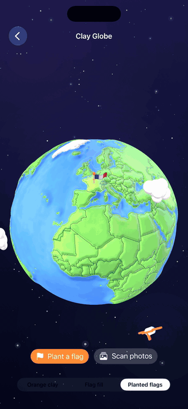

# ClayGlobe
A claymorphic 3D globe for SwiftUI that plants a waving flag on every country you visit.

<p align="center">
  
</p>

<p align="center">
  
  
  [](https://github.com/haplollc/ClayGlobe/stargazers)
  [](LICENSE)
</p>

<p align="center">
  <a href="https://buymeacoffee.com/jcbuilds"></a>
  <br>
  <sub>If ClayGlobe is useful to you, a coffee keeps it going.</sub>
</p>

**Install**

```swift
dependencies: [
    .package(url: "https://github.com/haplollc/ClayGlobe", from: "1.0.0")
]
```

**Try it**

```swift
import SwiftUI
import ClayGlobe

struct TravelView: View {
    @StateObject private var globe = GlobeManager(visited: ["USA", "FRA", "JPN"])

    var body: some View {
        ZStack {
            GlobeNightSky()
            ClayGlobeView(manager: globe)
        }
    }
}
```

If this is useful, a star helps others find it.

---

## What you get

- **A hand-modeled feel, generated in code.** Every country is its own raised piece of clay on a matte plasticine sphere, with puffy clouds and a chubby little airplane circling the world.
- **Flag planting with ceremony.** Mark a country visited and the camera tours to it, a flag pole drops in, and the flag waves on a GPU cloth shader.
- **Photo library scanning.** One call reads photo location metadata (never the images), figures out every country the user has photographed in, and plants them all. Fully offline, nothing leaves the device.
- **Offline reverse geocoding.** Coordinate to ISO country code lookups against bundled map data, no network, no API key.
- **Three looks.** Orange clay, flag fill, or planted flags. U.S. states can render as their own pieces too.
- **Interactive by default.** Idle spin, drag to orbit, pinch to zoom, tap to squish.

## Installation

Add ClayGlobe with Swift Package Manager. In Xcode: **File > Add Package Dependencies** and paste

```
https://github.com/haplollc/ClayGlobe
```

Or in `Package.swift`:

```swift
dependencies: [
    .package(url: "https://github.com/haplollc/ClayGlobe", from: "1.0.0")
]
```

## Quick start

Two lines to a living globe:

```swift
import SwiftUI
import ClayGlobe

struct TravelView: View {
    @StateObject private var globe = GlobeManager(visited: ["USA", "FRA", "JPN"])

    var body: some View {
        ZStack {
            GlobeNightSky()                    // optional starfield backdrop
            ClayGlobeView(manager: globe)
        }
    }
}
```

Plant a flag whenever something happens in your app:

```swift
globe.plant("BRA")          // camera tour + flag drop + wave
globe.plant("ITA", "EGY")   // plant several at once
globe.remove("FRA")         // quietly take one off
```

Countries are ISO 3166-1 alpha-3 codes ("JPN", "FRA", "USA"). U.S. states use USPS codes ("CA", "NY") via `globe.visitedStates`.

## Celebrations

Freshly planted countries can erupt in a burst of their own waving emoji flags. Overlay the celebration view and it fires automatically:

```swift
ZStack {
    GlobeNightSky()
    ClayGlobeView(manager: globe)
        .overlay { GlobeCelebration(manager: globe) }
}
```

## Scan the photo library

Let the globe fill itself in from the user's existing photos:

```swift
Button("Find my countries") {
    Task {
        if let result = await globe.scanPhotoLibrary() {
            print("Planted \(result.newCountries.count) new countries")
            print("First trip to Japan: \(result.firstVisits["JPN"] ?? .now)")
        }
    }
}
```

The scan reads `PHAsset` location metadata only. No pixels are loaded, nothing is uploaded, and a library of thousands of photos resolves in seconds. Access is requested automatically; the call returns `nil` if the user declines.

Add the usage string to your target's Info settings:

```
NSPhotoLibraryUsageDescription
"Used to find countries you have visited from your photo locations. Nothing leaves your device."
```

Prefer to drive things yourself? `VisitedCountryScanner` is public:

```swift
guard await VisitedCountryScanner.requestAccess() else { return }
let findings = await VisitedCountryScanner.scan()
// findings.countries, findings.states, findings.firstVisits
```

## Styles

```swift
globe.style = .planted   // brighter green + a planted waving flag (default)
globe.style = .flags     // countries filled edge to edge with their flag
globe.style = .clay      // visited countries as orange clay
```

`GlobeStyle` is `CaseIterable` with a `displayName`, so a picker is one line:

```swift
Picker("Style", selection: $globe.style) {
    ForEach(GlobeStyle.allCases) { Text($0.displayName).tag($0) }
}
```

## Configuration

```swift
var config = GlobeConfiguration()
config.holdsStill = true      // freeze the idle spin and camera tours
config.showsUSStates = false  // keep the USA as one piece
let globe = GlobeManager(configuration: config)
```

`holdsStill` is handy for marketing captures and for honoring Reduce Motion.

## Offline lookups

The bundled atlas answers geography questions with no globe on screen at all:

```swift
GlobeManager.countryCode(latitude: 35.68, longitude: 139.69)   // "JPN"
GlobeManager.countryName(for: "JPN")                           // "Japan"
GlobeManager.flagEmoji(for: "JPN")                             // the Japanese flag emoji
GlobeManager.allCountryCodes                                   // every code on the globe
```

## How it is built

- **SceneKit** sphere with each country extruded from simplified boundary polygons, so the world reads as pieces of clay rather than a printed texture.
- **Flags wave on the GPU.** A tiny shader modifier bends each flag with overlapping sine waves pinned at the pole.
- **Country resolution is ray-cast point-in-polygon** over bundled boundary data, with even-odd winding so enclaves like Lesotho resolve correctly.
- **The starfield is one SwiftUI `Canvas`** with seeded star positions, so it animates cheaply and never re-rolls.
- **MVVM.** `GlobeManager` is the only object you talk to; views observe it.

## Requirements

- iOS 17.0+
- Swift 5.9+ / Xcode 15+

## License and data

ClayGlobe is available under the [MIT license](LICENSE).

Country and state boundaries are derived from [Natural Earth](https://www.naturalearthdata.com), a public domain map dataset. Flag imagery is rendered from the emoji set of the host OS at runtime; no flag artwork ships with the package.

Made by [Haplo LLC](https://haploapp.com). Extracted from [Bilbo](https://haploapp.com/bilbo), our travel planning app, where the globe fills in as you travel.
---

## More from Haplo

More open source from [Haplo](https://github.com/haplollc), built by the same solo developer:

- [ThinkingOrbs](https://github.com/haplollc/ThinkingOrbs): dotted, honestly-3D loading indicators for AI and agent interfaces in SwiftUI. Nine hand-tuned designs, two tuned sizes.
- [Minted](https://github.com/haplollc/Minted): turn any SVG into a physically-lit 3D gold medallion for SwiftUI.
- [Vesalius](https://github.com/haplollc/Vesalius): a map of your codebase for Claude Code, an on-device code graph with an MCP server, a CLI, a Mac app and a VS Code extension.
- [MuscleMapKit](https://github.com/haplollc/MuscleMapKit): interactive 3D muscle map for iOS. Shade muscles by how hard they were worked, spin the body, tap a group.
- [ProcessingField](https://github.com/haplollc/ProcessingField): a SwiftUI progress field, a grid of marks whose sizes describe one soft shape that drifts, folds and breathes while your app is busy.
- [Gepetto](https://github.com/haplollc/Gepetto): a browser agent for iOS and macOS that a person can take over at any time. Real WKWebView, small on-device models, a native SwiftUI panel.
- [Mirage](https://github.com/haplollc/Mirage): one-stop on-device diffusion image-generation engine for iOS / macOS / visionOS.
- [SiriGlass](https://github.com/haplollc/SiriGlass): the Siri drop from iOS 27, for SwiftUI. Liquid Glass that pours out of the Dynamic Island and lights up with your voice.
- [Scrubbers](https://github.com/haplollc/Scrubbers): twelve sliders you will want to touch, for SwiftUI. One view, one enum.
- [KoiPond](https://github.com/haplollc/KoiPond): a living koi pond for SwiftUI. Koi glide over any view, lily pads drift on top, and a Metal shader ripples and refracts it all.
